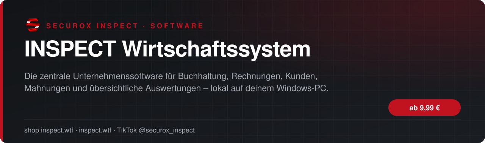
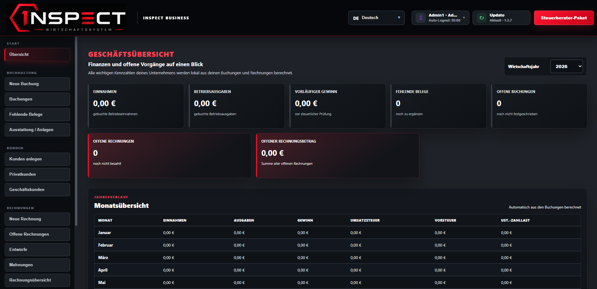
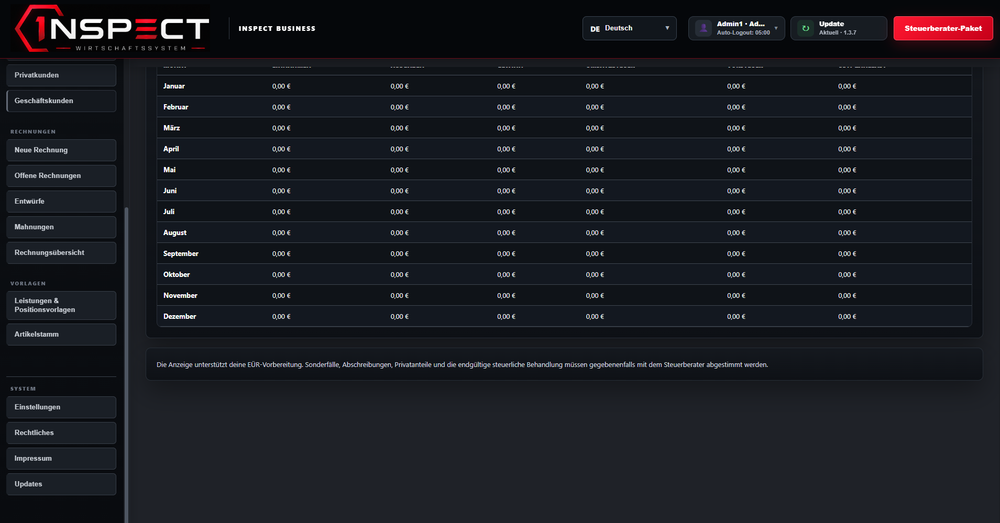

<!-- inspect-showcase: automatisch erzeugt, Änderungen bitte im Shop vornehmen -->

  
  
  
  

  
  
  

 

 

## Das Wichtigste auf einen Blick

<table>
  <tr>
    <td width="50%" valign="top">✔&nbsp; <b>Einnahmen und Ausgaben strukturiert verwalten</b></td>
    <td width="50%" valign="top">✔&nbsp; <b>Buchungen kategorisieren und mit Belegen ergänzen</b></td>
  </tr>
  <tr>
    <td width="50%" valign="top">✔&nbsp; <b>Fehlende Belege schnell erkennen</b></td>
    <td width="50%" valign="top">✔&nbsp; <b>Professionelle Rechnungen erstellen und verwalten</b></td>
  </tr>
</table>

## Überblick

#### DEINE UNTERNEHMENSVERWALTUNG – EINFACH, MODERN UND ZENTRAL

Mit dem INSPECT Wirtschaftssystem verwaltest du Buchhaltung, Rechnungen, Kunden, Mahnungen und Auswertungen übersichtlich in einer einzigen Anwendung.

#### BUCHHALTUNG

Erfasse Einnahmen und Ausgaben strukturiert, ergänze Buchungsdaten, Kategorien, Beschreibungen und Belege und behalte fehlende Unterlagen jederzeit im Blick.

#### RECHNUNGEN

Erstelle professionelle Rechnungen mit Kundendaten, Positionen, Preisen, Zahlungsarten und Skonto. Offene und bezahlte Rechnungen werden übersichtlich getrennt verwaltet.

#### KUNDENVERWALTUNG

Verwalte private und geschäftliche Kunden zentral und übernimm vorhandene Kundendaten direkt in neue Rechnungen.

#### MAHNUNGEN UND OFFENE ZAHLUNGEN

Behalte Fälligkeiten und offene Rechnungen im Blick. Mahnungen können vorbereitet, ausgegeben und anschließend als bezahlt markiert werden.

#### MONATS- UND JAHRESAUSWERTUNGEN

Vergleiche Einnahmen, Ausgaben, offene Rechnungen und wichtige Unternehmenswerte über verschiedene Zeiträume hinweg.

#### EXPORT

Exportiere deine Daten für die eigene Ablage, zur weiteren Bearbeitung oder zur Weitergabe an eine fachkundige Stelle.

#### LOKALE DATENSPEICHERUNG

Das INSPECT Wirtschaftssystem arbeitet lokal auf deinem Windows-PC. Deine Unternehmens-, Kunden- und Finanzdaten müssen nicht dauerhaft in einer externen Cloud gespeichert werden.

◆ FÜR WEN IST DIE SOFTWARE GEEIGNET?

Ideal für Selbstständige, Einzelunternehmen, Dienstleister und kleinere Betriebe, die ihre kaufmännischen Abläufe professionell und übersichtlich organisieren möchten.

#### HINWEIS

Das INSPECT Wirtschaftssystem dient der Organisation, Verwaltung und Dokumentation betrieblicher Daten. Es ersetzt keine individuelle Steuer-, Rechts- oder Unternehmensberatung.

## Alle weiteren Funktionen

- Offene und bezahlte Rechnungen getrennt organisieren
- Private und geschäftliche Kunden zentral verwalten
- Kundendaten direkt in Rechnungen übernehmen
- Artikel, Positionen, Zahlungsarten und Skonto erfassen
- Offene Zahlungen und Fälligkeiten im Blick behalten
- Mahnungen vorbereiten und verwalten
- Monats- und Jahresübersichten
- Übersicht wichtiger Unternehmenskennzahlen
- Darstellung von Umsatzsteuer, Vorsteuer und Zahllast
- Exportmöglichkeiten für Ablage und Weiterverarbeitung

<b>6 weitere Funktionen anzeigen</b>

- Steuerberater-Export
- Lokale Datenspeicherung auf dem eigenen Windows-PC
- Datensicherungs- und Wiederherstellungsfunktionen
- Mehrsprachige Benutzeroberfläche
- Moderne schwarz-rote INSPECT-Oberfläche
- Klare Navigation und verständliche Eingabemasken

## Einblicke

<table>
  <tr>
    <td width="50%"></td>
    <td width="50%"></td>
  </tr>
</table>

## Laufzeiten & Preise

| Laufzeit | Preis |
|:--|--:|
| 3 Tage | **9,99 €** |
| 7 Tage | **14,95 €** |
| 14 Tage | **19,99 €** |
| 30 Tage | **29,99 €** |
| 3 Monate | **49,99 €** |
| 6 Monate | **89,99 €** |
| 12 Monate | **139,99 €** |
| 24 Monate | **249,99 €** |
| Lifetime | **499,95 €** |

Sichere Zahlung mit PayPal oder Kreditkarte · Rechnung als PDF · Support auf Deutsch

## So einfach geht's

1. **Im Shop kaufen** – sicher bezahlen mit PayPal oder Kreditkarte.
2. **Sofort loslegen** – Download und Lizenz stehen direkt nach Zahlungseingang in deinem Kundenkonto bereit, die Rechnung erhältst du als PDF.
3. **Einrichten** – bei Fragen hilft dir unser Support im Discord weiter.

## Warum INSPECT?

<table>
  <tr>
    <td width="50%" valign="top"><b>🇩🇪 Entwickelt in Deutschland</b> Konzeption, Entwicklung und Support aus einer Hand.</td>
    <td width="50%" valign="top"><b>💬 Persönlicher Support</b> Schnelle Hilfe auf Deutsch im INSPECT Discord.</td>
  </tr>
  <tr>
    <td width="50%" valign="top"><b>🔒 Sichere Zahlung</b> PayPal oder Kreditkarte, Rechnung automatisch als PDF.</td>
    <td width="50%" valign="top"><b>⚡ Sofort verfügbar</b> Download und Lizenz direkt nach der Zahlung im Kundenkonto.</td>
  </tr>
</table>

## Häufige Fragen

<b>Wie erhalte ich das Produkt?</b>

 

Nach bestätigter Zahlung stehen Download und Lizenz in deinem Kundenkonto bereit. Die Rechnung erhältst du als PDF.

<b>Wie funktionieren die Laufzeiten?</b>

 

Du wählst beim Kauf die passende Laufzeit. Die Lizenz ist danach sofort aktiv und in deinem Kundenkonto einsehbar.

<b>Bekomme ich Hilfe bei der Einrichtung?</b>

 

Ja – unser Support hilft dir im [INSPECT Discord](https://discord.gg/inspect) persönlich und auf Deutsch.

<b>Wo kaufe ich offiziell?</b>

 

Ausschließlich im INSPECT Shop unter [shop.inspect.wtf](https://shop.inspect.wtf). Angebote von Dritten stammen nicht von uns.

## Kontakt

| | |
|:--|:--|
| 🛒 Shop | [shop.inspect.wtf](https://shop.inspect.wtf) |
| 🌐 Website | [inspect.wtf](https://inspect.wtf) |
| 💬 Discord | [discord.gg/inspect](https://discord.gg/inspect) |
| 🎬 TikTok | [@securox_inspect](https://www.tiktok.com/@securox_inspect) |
| ✉️ E-Mail | [info@inspect.wtf](mailto:info@inspect.wtf) |

---

<b>SecuroX Inspect</b> · Offizielle Produktpräsentation · Dieses Repository enthält keinen Quellcode und keine Produktdateien. 
Kauf und Lizenzen ausschließlich über <a href="https://shop.inspect.wtf">shop.inspect.wtf</a> · Inhalte werden automatisch aus dem Shop aktualisiert.

